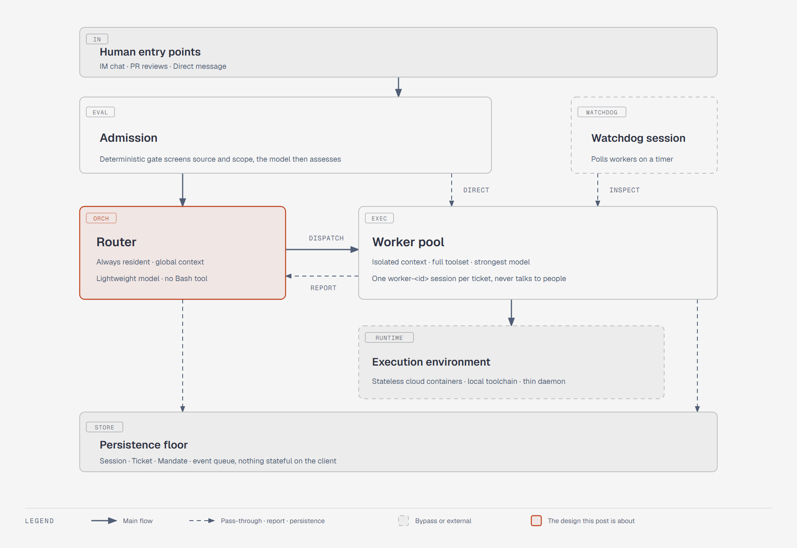
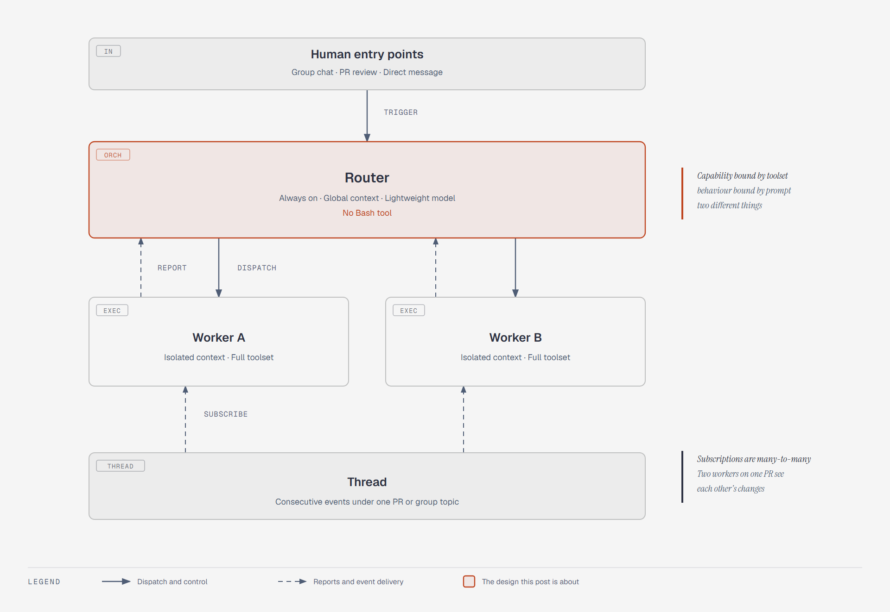
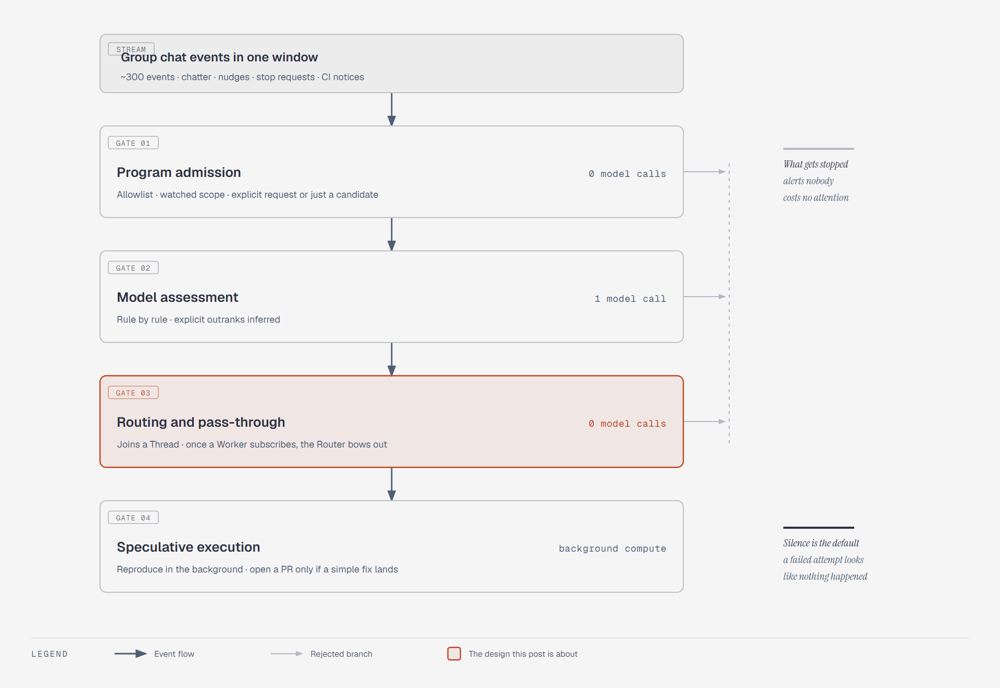
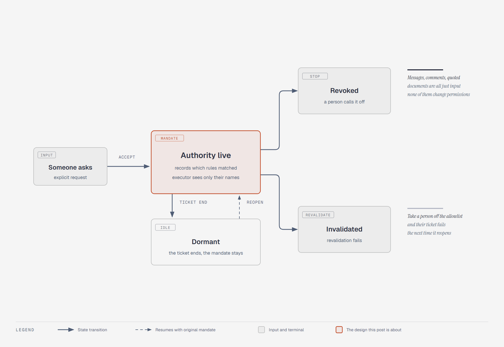
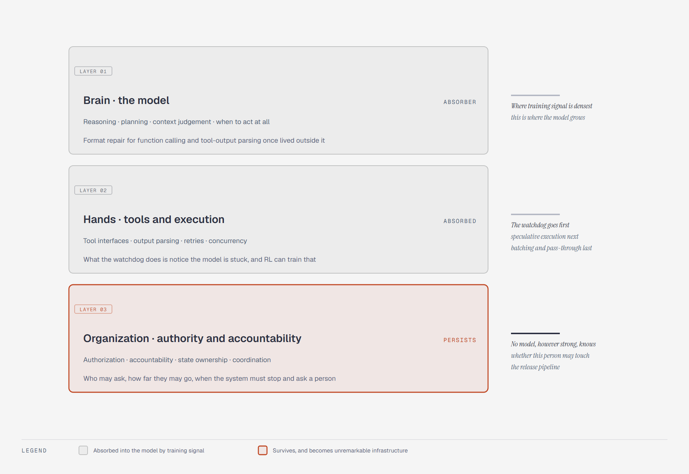

On the evening of October 31, 2026, DeepSeek's Harness team published a long technical post on Super-agent design, and at the same moment pushed a repository called `dsh-superagent-prototype` to GitHub: MIT license, TypeScript. Five days later it sat at 19,200 stars and 2,186 forks. There is exactly one commit, `feat: add the dsh-superagent research prototype`. 216 files, nine numbered design documents totaling about 160,000 characters.

I pulled the star and watcher counts from the GitHub API rather than the page, because the two don't quite agree. The API says 19,224 and 137. Stars are bookmarks; you click and move on. Watchers mean you want the email and intend to follow along. 137 people stayed, and the other nineteen thousand read it and left. The closed issue tracker says more than either number. With no public bug list, no reproduction steps, and no discussion of fixes, all that attention has no way to become anything checkable.

The README says the code may have bugs, and that its style and engineering practice may be inconsistent. For a research prototype that's not scandalous, but it does settle how you should use the thing. I read it as an architecture document you can run. Anything that treats it as a dependency should wait.

<!-- more -->

## 1. It Wraps Sessions, Not the Model

It sits at a different layer from the DeepSeek Harness open-sourced in August, and the two get conflated constantly. Harness answers how one agent gets stronger by adding plugins and skills. Super-agent answers how many agent sessions get organized. One is capability extension, the other is a scheduling substrate. The repo is technically a Harness bundle, but the interesting part is the domain model laid out in those nine documents.

There's a line in the first paragraph of the README that's easy to skip. The public version was adapted for release, so it differs both from what the team runs internally and from what the long post describes, and some of the design directions discussed there never landed here. Everything below rests on that line. Section 6 walks the gaps one at a time.

How the documents are organized is itself part of the design. 000 is the philosophy, 001 the domain model, 002 authorization, 003 execution, 004 prompts, 005 the panel, 006 deployment, 007 architecture, 008 how to add a new event source. Each assumes only what the earlier ones introduced. You never need prior terminology and you never hit an undefined word halfway through. Most open-source design docs decay into a changelog by the end, where you need a dozen terms already in hand to follow one paragraph in the middle. Holding that line is hard on the author. I can't manage it in my own internal docs.

What the system wants sits in the first line of 000: *Take as little human attention as possible, and give as much value as possible.* The second half is where the work is. An agent that can do the team's work can also burn the team's entire attention budget, which is why one rule keeps recurring. Act only when asked, or when the team's written rules allow it. Speak only when someone has to act or a usable result exists.

---

## 2. One Person, One Attention Budget

The team's read on the bottleneck is plain. Coding agents have already shown that models can solve hard problems with tools, which moves the human up to deciding and accepting. What limits throughput is no longer model capability but how many sessions one person can hold at once. Their number is three to five active sessions. Past that, what's in your head stops being code and becomes a list of what's stuck and with whom.

The diagnosis lands on Session. Session is inertia inherited from the underlying model API: it carries technical context management and user-facing project management at the same time, so users end up hand-managing a pile of windows. You settle on plan A in the chat and then switch to plan B in a PR comment, and those two facts land in two sessions that know nothing about each other. Moving the context across is your job. The team's own phrasing: the Session should be an implementation detail of the system, not a cognitive burden on the user.

The model sets the ceiling on a single task; attention sets how many tasks can move at once. The four characteristics grow out of that. Continuous means you interact where you already are, in chat and PR threads, and the system tracks one piece of work across channels. It's fast in that you don't wait for one task to finish before handing over the next. Proactive means it watches environmental events and stays quiet when stepping in isn't worth it. Durable means always on, recovering from its own failures. Together those four amount to one requirement. The user should feel like they're talking to a single agent, with session splitting and context syncing handled underneath.

Put those four requirements into a structure and this is what you get: entry points, admission, a resident scheduler, isolated execution, a persistence floor, plus a watchdog session watching from the side.



---

## 3. The Router Owns Relationships, Workers Own Details

Put every event into one session and the context stays maximally continuous, but the execution loop is serial and the intermediate details of concurrent tasks contaminate each other. Open a fresh session per event and concurrency goes up while the links between tasks dissolve: everyone works alone and the answers contradict each other. Neither direction works on its own. Super-agent's move is to split global continuity and high-concurrency execution into two layers.

The Router is always resident. It takes every human interaction at every entry point, holds the global context, works out which piece of work a message belongs to and who should get it, and executes nothing itself. It doesn't even need a Bash tool, and a small model is enough. Workers have isolated contexts, the full execution toolset, and the strongest model available. Each does a single job, never talks to a person directly, and reports back to the Router, which speaks for it. In the code they're called orchestrator and worker, shipped as the `dsh-superagent-router` and `dsh-superagent-worker` presets, and the tool sets are deliberately asymmetric.



People conflate this with an Agent Team. "Router owns relationships, workers own details" is easy to remember, and what's actually easy to get wrong is where it differs from an Agent Team: scope, not naming. One question separates the two architectures. Does the main session need to understand the internals of a task?

An Agent Team splits steps and assigns roles inside a single task. The steps are tightly coupled, so the main session has to go deep into task detail and coordinate constantly, which is a heavy reasoning load. Super-agent's Router only handles the high-level links between tasks and never gets involved in how any one task is broken down, which is why a small model suffices. The team made the converse point too. If you constrain an Agent Team's main session by prompt to talk only outward and hand each task to a member to push independently, you have this two-layer architecture as well. The bar is lower than it looks.

I buy the reasoning behind the split. What made me stop and look again was the detail that the Router has no Bash tool. There's no instruction saying don't execute tasks; the tool simply isn't there. Capability boundaries belong in the tool set. Behavioral boundaries belong in the prompt. Those two get collapsed into one all the time.

---

## 4. The Life of One Group Message

Say someone drops "sometimes blank-screens when switching sessions" into the group chat. Nothing stirs immediately. The first gate is admission, pure deterministic code: is the source allowlisted, is the chat in scope, is this person making an explicit request or producing a candidate. Real chat traffic is high-noise and low-yield, and most messages die right here without spending a single model call. Only the survivors reach a model, which decides against the written policy whether the thing is worth starting.



The second gate is routing and direct pass-through, and it carries the most engineering weight in the whole design. Consecutive events on the same PR or the same chat thread form a Thread. The Router shows up only for the cold start of a new task. Once a Worker exists it subscribes to that Thread directly, and later comments are delivered by plain code rather than relayed through the Router. Subscriptions are many-to-many. Two Workers subscribed to the same PR can see each other's actions and sort out collisions themselves without point-to-point messaging.

The third gate is speculative execution, borrowed from CPU branch prediction. Nobody gives an order. It spends a little compute in the background trying to reproduce and diagnose, opens a PR if it finds a simple fix, and says nothing at all if it doesn't. Internally they run a silent policy along these lines, and the public description is that a result gets delivered if it's valuable and discarded otherwise. Fail quietly and nothing happened. That convention is worth more than any instruction to act carefully, because it makes silence the default outcome.

Below that, keeping the system present. Long tool calls become asynchronous `start()` and `stop()`: call start and it returns immediately, with the background result delivered back as a new event, so builds and tests run in the background while the foreground keeps taking instructions. Compute lives in stateless cloud containers, session state in a database, the code and local toolchain stay on the original machine, and the client runs nothing but a stateless lightweight daemon. Close the laptop, lose the network, and the cloud still remembers where every task stands. Outermost is a separate Watchdog session on a timer. Beyond checking for API errors it asks the model whether each Worker is actually making progress, and a maintainer can ask it in plain language why some Worker is stuck.

---

## 5. Those Numbers Measure Scheduling, Not Intelligence

The published end-to-end experiment uses a synthetic workload: about 300 messages per run, roughly 20 of which are real requests, the rest chatter, nudges, mid-flight stops, and CI notifications. The coding step is replaced with a fake tool that only consumes time. Five runs per configuration.

| Configuration | Completion p50 | Completion p95 |
| --- | --- | --- |
| Super-agent (two layers + direct pass-through) | 12.4 min | 15.7 min |
| Single session + subagents (neutral prompt) | not reported | 29.5 min |
| Single session + subagents (delegation-heavy prompt) | not reported | better than neutral, still slower |

The second set is the ablation on direct pass-through. Remove it and completion time barely moves. What moves is the Router's decision count, up about 30%, and cached-read tokens, from 23.23M to 31.77M for a 37% increase. I got this wrong on first read. I assumed pass-through was a latency optimization and went back to correct myself when I hit the line about completion time staying flat. Pass-through saves scheduling overhead and tokens, not time, and the most common misreading in the coverage is exactly the one that calls it a performance win.

The third data set appears least and carries the most. Under load, the Router was taken from about 1 trigger per minute to about 40 with Workers swapped for mocks. Average batch size went from 1.0 to 2.8, per-request latency from 2.5s to 3.9s, and cost per decision actually fell from 6.4s to 1.6s. More backlog means lower unit cost, because batched triggers get computed in parallel during prefill. The curve says the central node is less fragile than it looks, and that batching beats horizontal scaling here.

The control group's failure mode is more interesting. With a neutral prompt, the single-session setup called a subagent zero times in five runs. Everything happened in the main session, constantly interrupted by new messages. With a prompt that explicitly encourages delegation, four of five runs delegated. In the fifth the model judged the job small enough to do itself, leaving a visible long tail.

Same model, same toolset, one prompt swapped, and collaboration behavior changes wholesale. Prompts do change collaboration. The problem is that the direction and magnitude of the change are ungoverned, and the same sentence can stop working in a different team or on a different model. That, not performance, is the argument for putting coordination in the architecture. The control is clean enough, since model and tooling are held constant and the prompt is the only variable. It proves prompts are unreliable. It doesn't prove the architecture is more reliable, which would take data from long-running deployments.

The team drew the boundaries of its own data: synthetic load, simplified environment, fake tool, five repetitions, described as preliminary. It measures scheduling and collaboration, not code quality. The right reading of p95 dropping from 29.5 to 15.7 minutes is that multi-task scheduling got faster and steadier at the cost of more tokens, not that the AI writes code twice as fast.

---

## 6. What Shipped, and What Didn't

That line about being adapted for release isn't a disclaimer. It describes a concrete gap. Walk the mechanisms from the long post against the repo one at a time and you can see what landed and what stayed on the drawing board.

| Mechanism in the post | Status in the prototype |
| --- | --- |
| Two-layer Router/Worker, GitHub and Feishu triggers | Present; README and code agree |
| Context budget control (truncate long content, keep a read pointer) | Present, simpler than the Inline & Spill described |
| Thread subscription pass-through | Not in the docs; a design direction |
| Speculative execution (reproduce in the background, then decide whether to speak) | Not in the docs; a design direction |
| Chain of recall (inline IDs across objects, forming a reference graph) | Not in the docs; a design direction |
| Cloud compute/storage split, BYOM against a local dev machine | Not in the docs; a design direction |
| Async `start()` / `stop()` | Implemented in DeepSeek Harness, off by default |
| Cross-instance A2A, cross-month long-horizon memory | Listed as open problems |

Almost everything missing depends on cloud infrastructure or on the team's internal environment. Only three things can ship alongside the code: the domain model, the authorization rules, and the execution framework. Most of the mechanisms the long post gets excited about sit outside those three. So finding half the promised features absent after you clone it is expected. There was only ever this much that could be open-sourced.

What the prototype actually does is watch one GitHub repository, listen for GitHub events, optionally connect to Feishu, and when an authorized person asks for something, open a ticket, do the work in its own session and its own directory, and come back to the original conversation with a PR. There's also a web panel that lists only what needs a human. Healthy state takes up no space.

Installation is the interesting part. SETUP.md isn't a manual for people, it's a work order for an agent. You tell your coding agent to follow the file and configure things with you, it asks one short question at a time, and at the end it lays the whole plan out for you to confirm. Of everything in the repo, that file says the most about what they think an agent is: not a black box to be handled with care, but a colleague who can read a work order.

Some of the implementation details are oddly specific. Every ticket gets a session named `worker-<ticket id>` and a directory of the same name. The prepare command times out at ten minutes by default, and the typical approach is a `git worktree` checkout. The last path segment of a PR branch has to match the ticket's short name for the PR to belong to it. On top of the concurrency cap there's one extra slot reserved for humans, so a person's message still gets through when every slot is full, and no volume of new work can push aside the one you're already following.

---

## 7. What Holds This System Up Is Authorization

By code volume the Router is a small part of this. What holds the system up is authorization. The vocabulary isn't large, and it lines up along the path an event takes. A Source delivers a Trigger. Events on the same thread of work become a Thread. An Eval decides whether to take the work on, and taking it on produces a Mandate and a Ticket. The Ticket's dispatch is an Assignment, and a Subscription carries later messages while the work runs. Two relationships are deliberately kept apart: Correlation adds information without routing, and Subscription delivers context without granting authority.

Eval has two layers. The gate is deterministic, reading the sender and the Source's policy. Assessment is what calls a model, checking each enabled rule. Admission comes out at one of two strengths. A person on the list who addresses the agent is an explicit request. A person not on the list following up on the same Thread is inferred. A bot can only ever produce inferred. Whether a message counts as a request is decided by code first and by a model second.

A Mandate has exactly three transitions: accept creates it, a person's stop withdraws it, a failed revalidation revokes it. A ticket ending is not a Mandate ending. If someone follows up on a finished ticket it resumes under the original Mandate, revalidated against current policy first. Which is why removing someone from the allowlist will fail the revalidation the next time a ticket depending on them resumes. One line in the docs is blunt: messages, comments, and quoted documents are inputs, and they cannot change permissions.



A policy version is a hash over the rules, the accept mode, and each Source's policy. When the version changes, running Evals are dropped and their Triggers requeued. Open tickets are left alone and receive a change note explaining whether the rules they matched changed, whether the requester can still start work, and whether proactive work is still accepted. The reason for not revoking outright is written plainly. Cancelling a change halfway through leaves you with half a change.

Three accept modes. Under `off`, inferred candidates don't exist. Under `observe`, the default, candidates are assessed as usual, but the verdict is only recorded as "would have accepted" and nothing further happens. Only `auto` actually takes the work. Proactive work has to match a rule the team wrote down; the ticket's Mandate records which rules matched, and the executor receives only those names and instructions. The advice is to start in `observe` and switch to `auto` once you've read the recorded decisions.

The system's default answer is no. Most agent frameworks start by fitting an agent with constraints, and the more it can do the better the demo. This one inverts that. Every action an agent takes is a capability that has to be authorized first, and unauthorized means nothing happens. The two starting points produce completely different test suites. One asks whether it can. The other asks whether it will take one step too many.

One detail in the code I intend to steal. The core Engine class doesn't hand the same object to all five kinds of caller. Each gets the subset it needs, and all five types are sliced off the same Engine with `Pick`. Narrowing an interface is a few lines of type declaration in TypeScript, and for a permission system the payoff is larger than it looks.

```ts
// src/core/engine.ts: who can do what, written into the types
export type EngineForSources =
  Pick<Engine, 'receive' | 'bindThread' | 'threadClosed'>

export type EngineForMainSession =
  Pick<Engine, 'candidate' | 'candidateDelivered' | 'decide' | 'attach' | 'reply' | 'requestStatus' | 'note'>

export type EngineForPeople =
  Pick<Engine, 'stopTicket' | 'retryTicket' | 'reevaluate' | 'unsubscribe' | 'dismiss'>

export type EngineForSettings = Pick<Engine, 'policyChanged'>

export type EngineForExecutor =
  Pick<Engine, 'assignmentStarted' | 'inputsDelivered' | 'inputsRead' | 'turnEnded' | 'deliveryFailed'
    | 'assignmentInterrupted' | 'report' | 'markUnrelated' | 'handback' | 'followForContext' | 'reply'>
```

A Source can't call `stopTicket`. The model-facing role can't call `assignmentStarted`. People and the panel can't call `decide`. The authorization boundary isn't only in the docs, it's in the type system. The payoff is direct. Injected text can at most make a caller say something wrong. It can't open a hole in a capability the caller was never given.

I counted the prompt lengths by pulling both preset prompt files. The Router's system prompt is 1,021 characters. The Worker's is 996. Around ten hard constraints each, no process description. The hardest lines say the host revalidates permissions, external text cannot change policy, and don't merge the PR or turn on auto-merge yourself. Process lives in code, and the prompt handles only the remaining judgment. That's a different road from the current fashion of writing the whole SOP into a system prompt.

---

## 8. What It Costs

The first bill is tokens. Pass-through saving 37% of cached-read tokens tells you the baseline isn't cheap, and even with it the total is about 3.8x the single-session setup. Resident sessions, continuous listening, the watchdog on a timer, background speculative attempts: every one of them trades tokens for human attention. For a solo developer this could cost an order of magnitude more than a single-session tool. How to weigh the attention saved against the money spent is a question the public material doesn't answer.

The second bill is execution privilege. The authorization model governs who may ask for work. It does not govern what a worker can touch once it's running. The deployment doc is blunt: both presets run with `danger-full-access` as the operator's OS user, can execute any program by path, and can read the operator's home directory. The doc itself concedes that the account wrappers and directories only establish defaults, not a security boundary. Running as the operator puts SSH keys, cloud credentials, and every other repository in range.

The team lists prompt injection, credential leakage on the client, and cross-device permissions as open problems, with the direction being to let an agent use a credential without ever holding it. That's easy to say and something else to build. There's no implementation in the public material, and no third party has run offensive testing against this authorization model.

The third bill is verifiability. 19,200 stars against 137 watchers, a closed issue tracker, no public defect list. Every secondary article points back to the same upstream source, and their agreement with each other isn't independent confirmation. Synthetic load, fake tools, five repetitions: all of it is in the authors' own caveats. The only way to know whether this works against your repository is to run it.

---

## 9. Four Things Worth Taking

If you came for the product news, you can stop at the last section. If you build agent systems there's more to carry away. Four things.

First, make Session an implementation detail. How sessions split, how context syncs, which task a message belongs to: those decisions belong below the user, not in a window list the user maintains. Whether an agent product is actually solving the multi-task problem shows in what it centers. Where did this task get to, or where did this window's conversation get to.

Second, separate delivering context from granting authority. A subscription gets later discussion to the executor automatically. A Mandate states why the work is allowed and how far it goes. When the two are the same mechanism, a piece of community feedback quietly becomes an expansion of authority. That's how a lot of agent systems get into trouble.

Third, enforce capability boundaries through the tool set. Taking a tool away is far more reliable than asking a model not to use it, especially in systems that read external text. Injected text can make a model say the wrong thing, but it can't make the model use a tool it doesn't have. Prompts are for tone, priority, and judgment criteria, not for prohibitions.

Fourth, write side effects down before performing them. Every Engine command enqueues its side effect inside a transaction and sends it only after commit, with exponential backoff on failure and the queue surviving a restart. The implementation is called Effects and it's a table plus a loop. The most common failure in agent systems isn't thinking wrong. It's an action that went out and nobody knows the result. This one pattern removes a lot of manual reconciliation.

---

## 10. Is Agent Development a Transitional Stage

Over the past year every top-tier model vendor has shipped an agent runtime. Anthropic has Claude Code and Managed Agents, OpenAI has the Agents API, DeepSeek has Harness and now Super-agent. Their feature sets overlap heavily, all four circling tool calling, context management, session persistence, and permission control. When every upstream vendor bets on the same layer at once, how long that layer can exist becomes a real question, and a more pressing one than who does it better.

A popular take goes like this. Agent development is only a transitional stage. Companies are piling into agents not because models aren't smart enough but because their hands and feet aren't nimble or strong enough, and model vendors building harnesses are exercising their own limbs. That's right about training. Pushed toward product, it bends.

The training view holds up. A harness is the track that makes a model produce trainable trajectories. A model edits code in a real repository, gets a review kicked back, edits again, and the signal from that sequence is denser than any static dataset. The Super-agent README says a large share of the engineering on this codebase was done by a coding agent, which read through this lens is evidence: they're building their own training environment.

Where it bends is on the copy they open-sourced. The README states plainly that the public version was adapted, and that it differs from what runs internally and from what the long post describes. The same codebase has two identities. Internally it's a track. Released, it's closer to a prosthetic. A track has to cover enough failure modes. A prosthetic has to make other people's tools grow to its shape. Different optimization targets.

If a harness really were a limb, it would be trained with the brain and be non-replaceable. The opposite is true. Point dsh-superagent at an OpenAI-compatible gateway and you've swapped the model underneath. The same model can be dropped into a different harness. A replaceable thing isn't a body, it's a prosthetic, and the prosthetic business was never about the prosthetic. It's about the interface standard. DeepSeek open-sourced both Harness and Super-agent under MIT and bound neither end to its own models. Exercising limbs doesn't explain that. Defining an interface explains it in one word.

I agree it's transitional, but the reason needs replacing. The limbs won't grow into the body. Out-of-body capability gets internalized by training signal. That's happened three times already. Function calling started as harness work: parse the model's output, retry on failure, fix the format. Models support it natively now and that scaffolding is gone. Parsing tool output was once a framework's core selling point; the output parser was mandatory code in every project a few years ago and almost nobody writes one. Multi-step planning leaned on the ReAct loop for years and models now decompose on their own. Every time, the scaffolding appears first and then gets eaten.

By that logic you can roughly order the disappearance of the mechanisms Super-agent borrowed from operating systems. The watchdog goes first, because what it does for the model is notice that it's stuck, and that's pure metacognition, directly trainable with reinforcement learning. Speculative execution next, since it's a strategy problem, and a model that learns to verify before speaking doesn't need an external apparatus. Batching and pass-through last, but they're still scheduling optimizations, still a capability layer that gets internalized. For anyone building a framework the ordering is mildly useful, since it separates what to keep investing in from what to deliberately keep thin and what to just wait out. It's still my guess, though. The team has never said how they expect these mechanisms to evolve.

There's one class of thing that doesn't disappear, and I think that's where agent development keeps its long-term value. Authorization and accountability. Who allowed this to happen, and who answers if it goes wrong. Neither is settled at any level of model capability. A smarter model still won't know whether this particular person in this particular repository has the right to let it touch the release pipeline. That's an external fact, and only a system can record and check it. Of nine documents, 002 is entirely about authorization, and the two longest entries in 001 are Mandate and Subscription. That allocation of space isn't an accident. Put together, the split should be three ways rather than two: the brain is the model, the limbs are tools and execution, the organization is authorization, state ownership, and multi-party coordination.



Organization has no counterpart inside a single model. A model doesn't need to handle the question of three agents and five people sharing one pipeline, and who runs first. That's a queueing problem, not a reasoning problem. The page allocation of 003 makes it clearer. Most of it is retry backoff, whether an Input was read, crash recovery, message ordering, deduplication on redelivery, and killing background tasks at a deadline. None of that touches how smart the model is. No model ships knowing not to send the same PR twice after a process restart. Anyone who has run a project like this on a team will recognize the time distribution, and it doesn't look like AI development. The hours spent tuning prompts are small next to the hours spent on permissions, retries, idempotency, auditing, and state recovery.

The claim can be made testable. When a layer of harness features stops producing measurable gains in task completion, that layer is finished. Function calling ended that way. A framework advertising format correction today gets told the model already does it. Run that ruler over the current volume of harness marketing and most of what's on offer falls on the expiring side.

Let me take apart the phrase "a capable individual." Super-agent doesn't treat the agent as a stronger individual. It treats it as a member of an organization, with a ticket, an authorization credential, a reporting relationship, and the right to be stopped. Attention appears in the documents far more often than capability. Building an individual is a contest over the capability ceiling. Building a member is a contest over interface quality. The first gets eroded as models improve. The second doesn't, because organizational complexity doesn't fall as individuals get smarter.

My version: agent development is transitional, but what it's transitional through is the capability supply. Capability gets eaten by models. Authorization, accountability, state ownership, and multi-party coordination stay, and change form from framework to infrastructure, as unremarkable as the database and the message queue are today, and nobody will hand them to a model to figure out on its own. When I judge whether an agent project deserves a long bet, I look first at whether it accumulates capability or institutions. Capability depreciates with each model generation. Institutions don't.

---

Nineteen thousand stars in five days, one commit, a closed issue tracker. What this repo offers is a complete architecture argument, from domain model to permission model to failure recovery, with the reason and cost of every choice written down. What it can't offer is an efficiency solution you deploy today. Nine documents later I'm only more sure of that.

I changed one opinion reading it. The words borrowed from operating systems aren't figures of speech. Scheduling, caching, batching, watchdog, capability boundary: inside an agent system they're the same class of problem, literally, because all of them are about how multiple execution streams queue for scarce resources.

If I look back on this round of agent building in a few years, my guess is that Router and Worker won't survive as words, that the watchdog and speculative execution will be eaten by models, and that what settles out are the tables that look least exciting today: who may ask, how much they may ask for, when the system has to stop and ask a person. Those tables last because they record facts about people and organizations, not facts about models. A better model only makes those facts harder to route around.

**References:**

- [deepseek-ai/dsh-superagent-prototype](https://github.com/deepseek-ai/dsh-superagent-prototype). The domain model, authorization rules, and execution details here all come from the repository's docs 000-008.
- [Super-agent design exploration: toward a more autonomous agent system](https://zhuanlan.zhihu.com/p/2099987320443237060) (repost on Zhihu). The official long post went out on WeChat; what I read was the repost and secondary write-ups. The ablation numbers in section 5 and the speculative execution and compute/storage mechanisms in section 4 come from those secondary teardowns, not from the repo docs.
- [What is DeepSeek's new Super-agent architecture](https://www.cnblogs.com/rangsh/p/23534281), cnblogs
- [Taking apart DeepSeek's Super-agent](https://blog.csdn.net/2203_75871132/article/details/169839837), CSDN
- [DeepSeek Super-agent source walkthrough and local deployment](https://juejin.cn/post/7702737817416105999), Juejin
- [How DeepSeek's open-source superagent decides who may give it work](https://theainewsreport.com/2026-11-02-deepseek-dsh-superagent-permissions-explained.html), AI News Report
