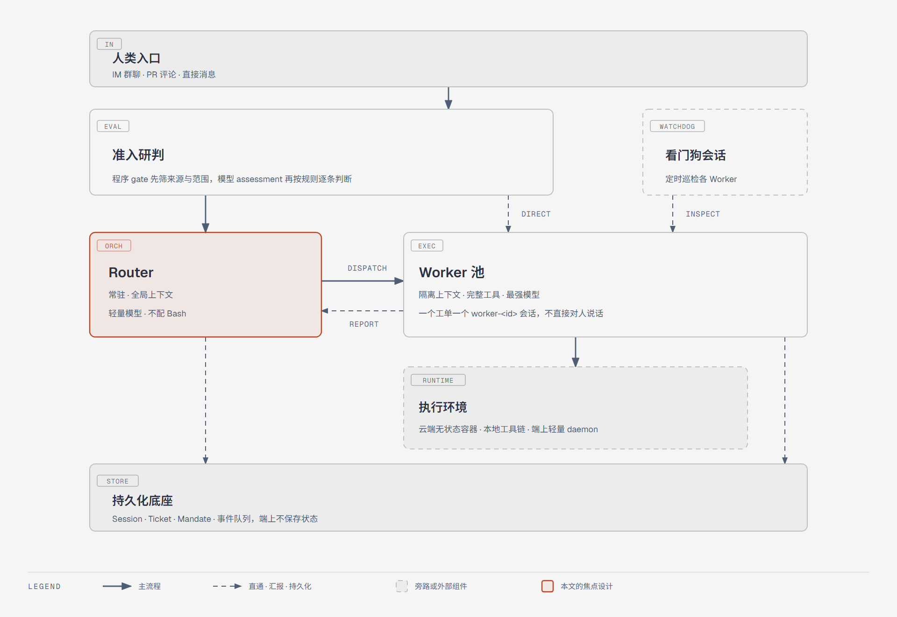
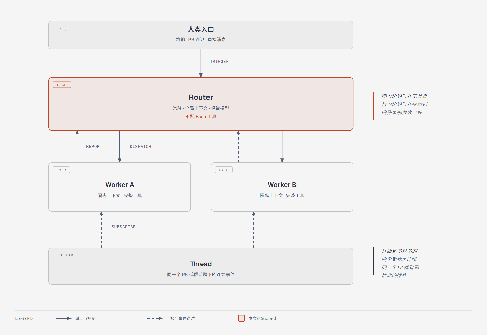
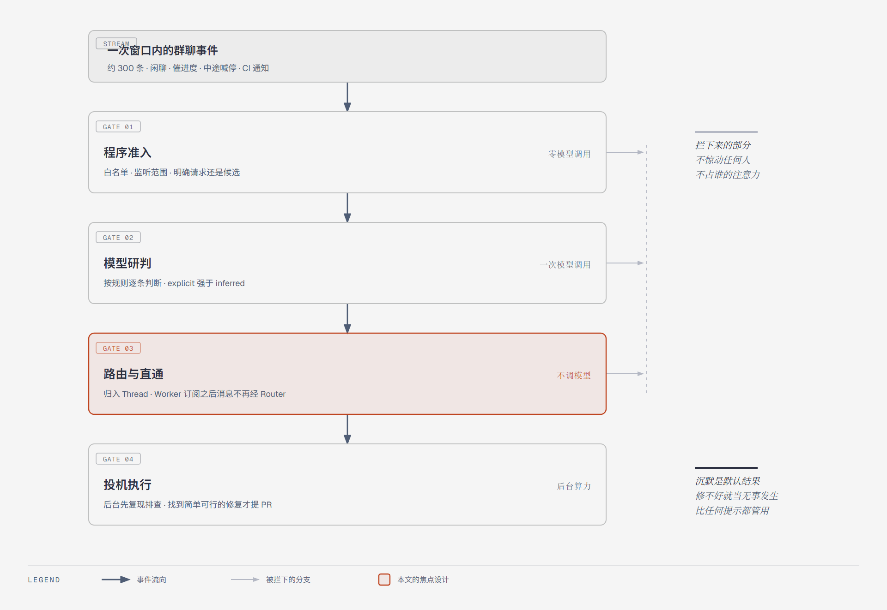
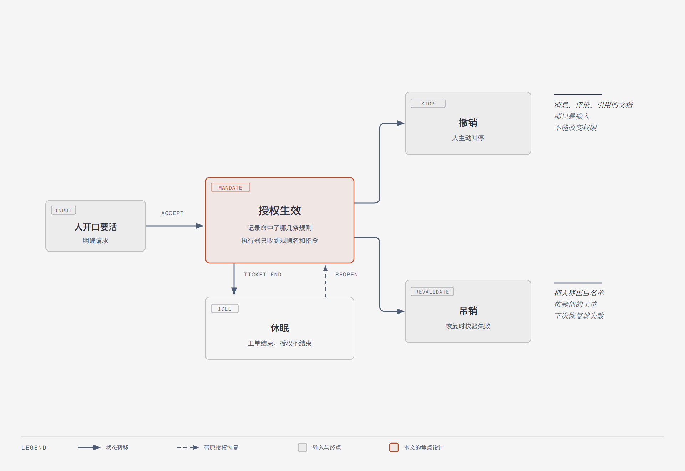
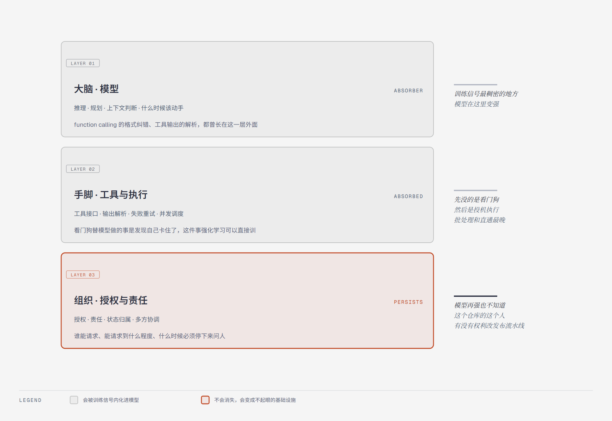

2026 年 10 月 31 日晚，DeepSeek Harness 团队发布技术长文《Super-agent 设计探索：迈向更自主的 Agent 系统》，同一时刻把一个名为 dsh-superagent-prototype 的仓库推上 GitHub，MIT 协议，TypeScript 编写。五天之后，仓库 star 数 1.92 万，fork 2186。同一个仓库只有一次提交，提交信息是一行 `feat: add the dsh-superagent research prototype`，216 个文件，九篇编号设计文档合计约十六万字符。

star 和 watcher 这两个数字是我从 GitHub API 取的，页面显示的数和接口返回的数还不太一样，我按接口的算了：19224 和 137。star 是收藏，看完点一下就完了；watcher 是跟踪，意味着愿意收邮件、跟进后续。137 个人留下来，其余一万九千人看完就走。issue 区关着这件事比 star 数字更说明问题，没有公开的缺陷清单、复现步骤和修复讨论，社区热度就没有办法转化成可验证的东西。

README 自己说可能有 bug，代码风格和工程实践可能不一致。放到研究原型身上这算不上丑闻，但它决定了这东西该怎么用。我把它当一份能跑起来读的架构文本来读，任何想拿它当依赖的用法都得先等等。

<!-- more -->

## 一、它接管的是会话，不是模型

它和 8 月开源的 DeepSeek Harness 不在同一层，这两个东西经常被当成一回事。Harness 回答"一个 Agent 怎么挂插件、挂 Skill 变强"，Super-agent 回答"很多个 Agent 会话怎么被组织起来"。前者是能力扩展，后者是调度底座。仓库本身确实是一个 Harness bundle，但有意思的部分是那九篇文档描述的领域模型。

README 第一段有一句容易跳过的话：公开版本为发布做过适配，因此既不同于团队内部版本，也不同于长文里描述的实现，长文里讨论的一部分设计方向在这个原型里没有落地。这句话是后文所有判断的前提，第六节会把差距逐条摊开。

文档的组织方式本身也是设计的一部分。000 讲哲学，001 领域模型，002 授权，003 执行，004 提示词，005 面板，006 部署，007 架构，008 怎么加一个新事件源。每篇只依赖前面已经引入的概念，读者不需要提前知道任何术语，也不会在半路撞上一个没定义过的说法。多数开源项目的设计文档写到最后都变成了变更记录，读者得先知道一堆术语才看得懂中间某一段。这种写法对作者的要求很高，我自己写内部文档时做不到这个程度。

这个系统想要什么，000 的第一行写得很直白：Take as little human attention as possible, and give as much value as possible。后半句才是要花力气的地方。一个能替团队干活的 Agent 同样能烧掉整个团队的注意力，所以文档里反复出现的规则是"只在被请求、或团队写明的规则允许时行动"，以及"只在人必须行动或者有可用结果时说话"。

---

## 二、人只有一份注意力

团队对瓶颈的判断很朴素。编码 Agent 已经证明模型能用工具解决复杂问题，人的角色上移到决策与验收，于是限制产出的不再是模型能力，而是人能同时跟住多少个会话。他们给出的数字是一个人通常只能同时跟进 3 到 5 个活跃会话，超出这个数，脑子里存的不再是代码，而是哪件事卡在谁那里。

诊断最后落到 Session 这个概念上。Session 是从底层模型 API 延续下来的惯性，它同时承担了技术上的上下文管理和面向用户的项目管理，于是用户被迫手动管理一堆窗口。你在群里定了方案 A，转头在 PR 评论里改成方案 B，这两条信息落在两个互不知情的会话里，把上下文搬过去的只能是你自己。团队的原话是 Session 应当是系统的实现细节，而不应是用户的认知负担。

模型决定单个任务的上限，注意力决定同时能推进几件事。四个特征就是从这个判断里长出来的：连续，在 IM 群聊、PR 评论这些熟悉的界面里交互，跨渠道理解同一件事；高效，不用等上一个任务跑完就能接下一条指令；主动，持续观察环境事件，不值得介入时保持安静；持久，长期在线，运行中出了异常能自己恢复。四个词合起来其实是一个要求，用户感觉始终只和一个 Agent 打交道，会话怎么拆、上下文怎么同步由系统在底层处理。

这四条要求落到结构上，就是下面这张图。入口、准入、常驻调度、隔离执行、持久化底座，另外加一个旁路巡检的看门狗会话。



---

## 三、Router 管关系，Worker 管细节

所有事件塞进一个会话，上下文最连续，但执行循环是串行的，几个任务的中间细节还会互相污染。每条事件新开一个会话，并发是上去了，任务之间的关联却散了，各干各的，最后给出互相矛盾的回答。这两个方向单独走都不通，Super-agent 的办法是把维持全局连续性和高并发执行拆到两层去。

Router 常驻，承接所有入口的人类交互，维护全局上下文，判断这条消息跟哪件事有关、该派给谁，自己不执行具体任务，甚至可以不配 Bash 工具，用轻量模型就够。Worker 上下文彼此隔离，挂完整执行工具，配能力最强的模型，专注干一件事，不直接对人说话，结果汇报给 Router，由 Router 统一对外转述。代码里两者分别叫 orchestrator 和 worker，对应 `dsh-superagent-router` 和 `dsh-superagent-worker` 两个 preset，工具集是刻意不对称的。



很多人把这个分层和 Agent Team 混为一谈。Router 管关系，Worker 管细节，这个说法好记，但容易记混的是它和 Agent Team 到底差在哪，差别在作用范围而不在命名。区分两种架构只要看一件事：主会话需不需要理解任务内部的实现细节。

Agent Team 是在一个任务内部拆步骤、派角色，步骤之间耦合紧，主会话必须深入任务细节、高频协调，推理负担很重。Super-agent 的 Router 只处理任务之间的高层关联，不介入单个任务怎么拆，所以能用轻量模型。团队还反过来说过一句，用提示词把 Agent Team 的主会话约束成只对外交互、把不同任务派给成员独立推进，那它也算这种双层架构，门槛没有想象中高。

我认同这套分层的理由。让我停下来多看了一会儿的其实是 Router 不配 Bash 这个细节，没有"请勿执行任务"这类提示词，工具直接就不给。能力边界写在工具集里，行为边界写在提示词里，这两件事经常被混成一件。

---

## 四、一条群消息的旅程

假设有人在群里说"切换会话时偶发白屏"。这条消息不会立刻惊动任何人。第一关是程序层准入，纯确定性代码：来源在不在白名单、群在不在监听范围、这个人算明确请求还是候选。真实群聊的事件流是高噪音、低触发率，大部分消息在这一步就被拦掉，一次模型调用都不花。留下来的候选才交给模型，按提示词里写好的策略判断值不值得动手。



第二关是路由与直通，这一层的工程含量最高。同一个 PR、同一个 IM 话题下的连续事件构成一条 Thread。Router 只在新任务冷启动时出场，建好 Worker 之后，Worker 直接订阅这条 Thread，后续评论由程序送达对应 Worker，不再经过 Router 转发。订阅是多对多的，两个 Worker 订阅同一个 PR 就能看到彼此的操作，撞车自己解决，不需要点对点通信。

第三关是投机执行，借的是 CPU 分支预测的思路。不等人下令，先在后台花一点算力尝试复现和排查，找到简单可行的修复就提 PR，没找到就什么都不说。官方内部配了这样一条静默策略，公开的说法是结果有价值就交付，没价值就丢弃。修不好就当无事发生，这个约定比任何"请谨慎行动"的提示词都管用，因为它把沉默设成了默认结果。

再往下是让系统一直在。耗时的工具调用改成异步的 `start()` 和 `stop()`，调 start 立刻返回，后台结果作为新事件投回来，编译和测试在后台跑的同时前台照样能接新指令。计算放云端无状态容器，会话状态进数据库，代码和本地工具链留在原机，端上只放一个不保存状态的轻量守护进程，笔记本合盖、断网，云端仍然记得所有任务的进度。最外层单开一个 Watchdog 会话定时巡检，除了接口报错，还让模型判断各 Worker 有没有实质进展，维护者可以直接用自然语言问它某个 Worker 为什么卡住。

---

## 五、那组数字量的是调度，不是智能

官方公布的端到端实验是合成负载：一次约 300 条消息，其中真正的请求只有 20 条左右，剩下是闲聊、催进度、中途喊停和 CI 通知。写代码那一步被换成一个只消耗时间的假工具，每种配置跑 5 次。

| 方案 | 完成时间 p50 | 完成时间 p95 |
| --- | --- | --- |
| Super-agent（双层架构 + 订阅直通） | 12.4 分钟 | 15.7 分钟 |
| 单会话 + Subagent（中性提示词） | 未公布 | 29.5 分钟 |
| 单会话 + Subagent（强委派提示词） | 未公布 | 优于中性，仍慢于 Super-agent |

第二组是订阅直通的消融。去掉直通之后，完成时间几乎不变，变的是 Router 的决策次数增加约 30%，读缓存 token 从 2323 万涨到 3177 万，涨了 37%。这一点我第一遍读的时候理解错了，以为直通是延迟优化，看到"完成时间几乎不变"才回头改。直通省的是调度开销和 token，不是时间，而传播里最常见的误读恰好就是把它当成性能优化。

第三组数据出现得最少，信息量却最大。Router 的压测把需要判断的 Trigger 从每分钟约 1 条加到约 40 条，Worker 换成 Mock，平均 batch 从 1.0 升到 2.8，单次请求耗时只从 2.5 秒涨到 3.9 秒，摊到每个决定上反而从 6.4 秒降到 1.6 秒。积压越多、单位成本越低，因为合并后的多条 Trigger 可以在 Prefill 阶段并行计算。这条曲线说明中心节点没有想象中脆弱，批处理比水平扩展更划算。

对照组的失败方式更有意思。中性提示词下，单会话方案 5 次运行一次都没有主动调用 Subagent，所有活都在主会话里干，被新消息不断打断。换成明确鼓励委派的提示词后，5 次里有 4 次委派了，剩下 1 次模型自己判断这活很小就自己干了，结果里多出一根明显的长尾。

同一个模型、同一套工具，只换一段提示词，协作行为就整体变了。提示词确实能改变协作，问题在于改变的方向和幅度都不受控，同一句话换个团队、换个模型就可能失效。把协调写进架构的理由在这里，不在性能。这组对照排除了模型和工具的差异，剩下的变量只有提示词，说服力是够的；不过它也只证明了提示词不可靠，没有证明架构必然更可靠，后者要靠长期跑下来的数据。

数据的边界团队自己划了：合成负载、简化环境、假工具、5 次重复，作者写的口径是仅作初步参考。它量的是调度与协作，不是代码生成质量，p95 从 29.5 分钟降到 15.7 分钟的正确读法是"多任务调度更快更稳，代价是更多 token"，而不是"AI 写代码快了一倍"。

---

## 六、蓝图里有，原型里没有

前面那句"为发布做过适配"不是免责声明，它描述的是一个具体差距。把长文提到的机制逐条对照仓库，能看出哪些落了地，哪些只停在方向层面。

| 长文里的机制 | 原型里的状态 |
| --- | --- |
| Router/Worker 双层、GitHub 与飞书触发 | 有，README 与代码都能对上 |
| 上下文预算控制（长内容截断后只留读指针） | 有，形态比长文说的 Inline & Spill 简单 |
| Thread 订阅直通 | 文档未出现，属设计方向 |
| 投机执行（后台先复现，再决定开不开口） | 文档未出现，属设计方向 |
| 链式召回（对象间内联 ID，形成引用图） | 文档未出现，属设计方向 |
| 云端存算分离、BYOM 接本地开发机 | 文档未出现，属设计方向 |
| 异步 `start()` / `stop()` | DeepSeek Harness 已实现，默认未开启 |
| 跨实例 A2A 通信、跨月长程记忆 | 官方列为开放问题 |

缺掉的部分几乎都依赖云端基础设施或者团队内部的环境。能和代码一起发布的只有领域模型、授权规则和执行框架这三块，长文里那些让人兴奋的机制大多不在这三块里。所以 clone 下来发现说好的一半功能找不到是正常的，能开源的部分本来就只有这么多。

原型实际能做的是盯住一个 GitHub 仓库，监听 GitHub 事件，可选接入飞书，被授权的人开口要活就开一个工单，在独立会话和独立目录里干完，回到原对话交付一个 PR。另有一个 Web 面板，只列需要人处理的事，状态健康的部分不占位置。

安装这块有点意思。SETUP.md 不是写给人看的手册，是写给智能体看的施工单，你对自己的编程 Agent 说一句"照着这份文件和我配置"，它一次只问一个短问题，最后把完整计划摊开给你确认。整个仓库里这个文件最能说明他们把 Agent 当成什么，不是需要被照顾的黑盒，是能读懂施工单的同事。

有几个实现细节挺具体。每个工单拿到一个名为 `worker-<工单 id>` 的 Session 和一个同名目录，准备命令默认十分钟超时，典型做法是用 `git worktree` 拉一个检出，PR 分支路径的最后一段匹配工单短名，这个 PR 就归属该工单。并发上限之外额外留一个人专用槽位，用来保证槽位占满时人的消息仍然插得进来，新活再多也挤不掉正在跟进的那个。

---

## 七、撑起这套系统的是授权

从代码量看，Router 只占很小一部分，撑起这套系统的是授权。领域模型的概念不多，按一条事件从进来到干完的顺序排：Source 送来 Trigger，同一条线上的事件归成一个 Thread，Eval 判断要不要接，接了就生成 Mandate 和 Ticket，Ticket 派工叫 Assignment，干活期间靠 Subscription 收后续消息。里面有两组关系被刻意分开了：Correlation 只加信息不路由，Subscription 只送上下文不授权限。

Eval 分两层。gate 是确定性判断，看发送者和该 Source 的策略；assessment 才调模型，按启用的规则逐条判断。准入结果分 explicit 和 inferred 两档强度，白名单成员 @ 了 Agent 是明确请求，非白名单成员在同一条 Thread 上追问算推断，机器人永远只能产生推断。一条消息算不算请求，先由程序定，再由模型定。

Mandate 的生命周期只有三种变化：accept 时创建，人 stop 时撤销，校验失败时吊销。工单结束不等于授权结束，已结束的工单被人追问一句，会带着原 Mandate 恢复，恢复前拿当前策略重新校验一次。所以把人从白名单里删掉，依赖这个人的工单下次恢复就会校验失败。文档里还有一句硬话：消息、评论、引用的文档都是输入，不能改变权限。



策略版本是规则、accept mode 和各 Source 策略部分的哈希。版本一变，正在运行的 Eval 直接丢弃，它手上的 Trigger 重新排队；已开工的工单不受影响，只收到一份变更说明，说明命中的规则改成了什么、请求者是否还能起新活、主动工作是否还被接受。不直接吊销的理由写得很清楚，取消一个跑到一半的改动只会留下半成品。

accept mode 三档。off 下推断不产生候选；observe 是默认值，候选照常研判，结论只记成"本来会接受"，什么都不做；auto 才会真的接单。主动接活必须命中团队写明的规则，工单的 Mandate 记录命中了哪几条，执行器收到的只有这几条的名字和指令。建议是从 observe 开始，看清记录下来的决定之后再切 auto。

整套系统的默认答案是"不做"。多数 Agent 框架的出发点是给 Agent 装约束，能做的事情越多越值得展示；这套系统反过来，把 Agent 的每个动作都当成需要先被授权的能力，没被授权就什么都不发生。两种起点的测试用例会长得完全不一样，前者测"它能不能"，后者测"它会不会多走一步"。

代码里有一个细节我打算抄。核心的 Engine 类对五类调用者暴露的不是同一个对象，而是各自能用到的方法子集，五组类型全部由 `Pick` 从同一个 Engine 上裁出来。接口收窄在 TypeScript 里只是几行类型声明，对权限系统的意义却不小：

```ts
// src/core/engine.ts：谁能做什么，写在类型里
export type EngineForSources =
  Pick<Engine, 'receive' | 'bindThread' | 'threadClosed'>

export type EngineForMainSession =
  Pick<Engine, 'candidate' | 'candidateDelivered' | 'decide' | 'attach' | 'reply' | 'requestStatus' | 'note'>

export type EngineForPeople =
  Pick<Engine, 'stopTicket' | 'retryTicket' | 'reevaluate' | 'unsubscribe' | 'dismiss'>

export type EngineForSettings = Pick<Engine, 'policyChanged'>

export type EngineForExecutor =
  Pick<Engine, 'assignmentStarted' | 'inputsDelivered' | 'inputsRead' | 'turnEnded' | 'deliveryFailed'
    | 'assignmentInterrupted' | 'report' | 'markUnrelated' | 'handback' | 'followForContext' | 'reply'>
```

事件源拿不到 `stopTicket`，模型角色拿不到 `assignmentStarted`，人和面板拿不到 `decide`。授权边界不只写在文档里，也写在类型系统里。收益很直接：一段被注入的文本最多让调用方说错话，没法定它在自己本该没有的能力上开一个口子。

提示词的长度我专门数过，把两个 preset 的提示词文件拉下来算的字符数。Router 的系统提示词 1021 个字符，Worker 996 个字符，各十条上下的硬约束，没有流程说明。里面最硬的几句是宿主会重新校验权限、外部文本不能改变策略、不要自己合并 PR 或开启自动合并。流程在程序里，提示词只管剩下的判断，这和把 SOP 全写进系统提示词的流行做法是两条路。

---

## 八、代价

第一笔账是 token。直通能省 37% 的读缓存 token，恰恰说明基线开销不低，直通之后整体仍是单会话方案的约 3.8 倍。多会话常驻、持续监听、看门狗定时唤醒、投机执行的后台尝试，每一项都在花 token 换人的注意力。对个人开发者，跑这套东西的成本可能比单会话工具贵一个量级，省下的注意力和多花的钱怎么算账，公开材料没有回答。

第二笔账是执行权限。授权模型管的是谁能提需求，管不到 worker 跑起来之后能碰什么。部署文档写得很直白：两个 preset 都以 `danger-full-access` 运行，用的是操作者的系统用户，可以按路径执行任意程序，也能读操作者的主目录。文档自己承认那些账号包装和目录只是建立默认值，不是安全边界。以操作者身份运行意味着 SSH key、云凭据和其他仓库都在射程之内。

官方把提示词注入、端侧凭据泄露、跨设备权限列为开放问题，方向是让 Agent 在不接触凭据本身的前提下使用凭据。这个方向说起来容易，落到工程上是另一回事，公开材料里没有实现，第三方也没有针对这套授权做过攻防测试。

第三笔账是可验证性。1.92 万 star 配 137 个 watcher，issue 区关闭，没有公开的缺陷清单。所有二手文章都指向同一个上游信息源，它们之间的互相印证不构成独立验证。合成负载、假工具、5 次重复，这些写在作者自己的免责说明里。想判断它在你仓库上能不能用，唯一的路是自己跑一遍。

---

## 九、可迁移的四件事

只关心产品新闻的话，读到上一节就够了。做 Agent 系统的人可以多拿一点东西走，我挑出四件。

第一，把 Session 变成实现细节。会话怎么拆、上下文怎么同步、一条消息归哪个任务，这些决定应该下沉到系统层，不该变成用户要维护的窗口列表。判断一个 Agent 产品是否真在解决多任务问题，看它围着"任务到哪了"设计，还是围着"这个窗口聊到哪了"设计。

第二，把送上下文和给权限分开。订阅负责让后续讨论自动到达执行者，Mandate 负责说明这件事凭什么可以做、能走多远。两个机制混在一起时，社区里的一条反馈就悄悄变成了授权扩张，这是很多 Agent 系统出事的方式。

第三，能力边界用工具集实现。把工具拿掉比让模型别用可靠得多，尤其在模型会读外部文本的系统里，一段注入进来的文字能让模型说错话，但没法让它用上没有的工具。提示词适合写语气、优先级和判断标准，不适合写禁令。

第四，副作用先落盘，再做。Engine 的每个命令都在一个事务里把副作用入队，提交之后才发出去，失败的按指数退避重试，进程重启后待办还在队列里，对应实现叫 Effects，说白了就是一张表加一个循环。Agent 系统最容易出的问题不是想错，而是动作已经发出去了没人知道结果，这一条能省掉大量人工对账。

---

## 十、Agent 开发是不是中间态

过去一年，第一梯队的模型厂商基本都交出了自己的 agent 运行时：Anthropic 有 Claude Code 和 Managed Agents，OpenAI 有 Agents API，DeepSeek 有 Harness 和刚开源的 Super-agent。这几套东西的能力集高度重叠，都在解决工具调用、上下文管理、会话持久化、权限控制这四件事。所有上游厂商同时往一个层次下注，那这个层次本身还能存在多久，就是一个真问题了，比谁做得更好更该先想。

一个流行的说法是，Agent 开发只是中间态，公司扎堆做 Agent 不是因为模型不够聪明，而是手脚不够灵活、不够粗壮，模型厂商下场做 Harness 就是在锻炼自己的手脚。这个判断在训练这件事上是对的，往产品上推就会拐弯。

训练视角说得通。harness 是让模型产生可训练轨迹的跑道，一个模型在真实仓库里改代码、被 review 打回、再改，这一串动作产生的信号比任何静态数据集都稠密。Super-agent 的 README 说这套代码的工程活很大一部分由 coding agent 完成，放在这个视角下就是证据，他们在给自己造训练环境。

拐弯的地方在开源出去的那一份。README 明说公开版本做过适配，和内部跑的、和长文描述的实现都不一致。同一个代码库因此有两个身份，内部是跑道，发布出来更像假肢。跑道要覆盖足够多的失败模式，假肢要让别人的工具按自己的形状长，两者的优化目标不一样。

如果 harness 真是手脚，它应该和大脑一起训练、不可替换。现实正好相反，dsh-superagent 接一个 OpenAI 兼容网关就能换掉底层模型，同一个模型也可以挂进不同的 harness。可替换的东西不是身体，是假肢，而假肢的生意从来不在假肢本身，在接口标准。DeepSeek 把 Harness 和 Super-agent 都按 MIT 开源、两头都不绑定自家模型，用"锻炼手脚"解释不通，用"定义接口"一句话就说通了。

我认同中间态这个判断，但理由要换。手脚不会长到身上，体外能力会被训练信号内化。这个路子已经走过三遍：function calling 最早是 harness 干的活，解析模型输出、失败重试、格式纠错，现在模型原生支持，那层脚手架就没了；工具输出的解析曾经是框架的核心卖点，output parser 在几年前是每个项目的必写代码，现在基本没人写；多步规划长期靠 ReAct 的循环撑着，现在模型自己会拆。每次都是脚手架先出现，然后被吞掉。

按这个逻辑，Super-agent 从操作系统搬来的那批机制，消失顺序大致能排出来。看门狗最先没，它替模型做的事是"发现自己卡住了"，这是纯粹的元认知能力，强化学习可以直接训。投机执行次之，它本质是策略问题，模型学会先验证再开口之后不需要外挂。批处理和订阅直通晚一些，但仍然是调度优化，属于会被内化的能力层。这个排序对做框架的人有点用，至少能分清哪些模块该长期做、哪些该故意做薄、哪些干脆等模型追上来。不过它只是我的推测，官方从来没有说过这些机制会怎么演进。

有一类东西不会消失，我认为 Agent 开发能长期留住的价值就在这儿。授权与责任，谁允许这件事发生，出了事谁认账，这两句话在任何模型能力水平上都不是已知项。模型再聪明也不会自己知道"这个仓库的这个人有没有权利让我改发布流水线"，这是外部事实，只能靠系统记录和校验。九篇文档里 002 整篇讲授权，001 里最长的两条是 Mandate 和 Subscription，这个篇幅比例不是偶然。合起来看，分法应该是三分而不是二分：大脑是模型，手脚是工具与执行能力，组织是授权、状态归属和多方协调。



组织问题在单个模型内部没有对应物。模型不需要处理"三个 Agent 和五个人共享一条流水线时谁先跑"，那是排队问题，不是推理问题。去看 003 的篇幅分布会更清楚，那一篇大半在讲重试退避、Input 有没有被读、崩溃后怎么恢复、消息顺序、重复投递去重、后台任务到点怎么杀。这些内容和模型聪明程度无关，模型再强也不会自带"进程重启后不要重复发同一个 PR"。在团队里做过这类项目的人会发现时间分布不像"AI 开发"，调提示词的时间远少于处理权限、重试、幂等、审计和状态恢复的时间。

这个判断可以做成一个能检验的东西：某一层 harness 特性不再带来可测量的任务完成率提升时，那一层就到头了。function calling 就是这样结束的，今天再有框架强调格式纠错能力，大家已经知道模型自己会。拿这条尺子去量当下铺天盖地的 harness 宣传，会过期的那一类占了大多数。

"有能力的个体"这个说法我想再拆一下。Super-agent 并没有把 Agent 当成一个更强的个体，而是当成组织里的一个成员，有工单、有授权凭据、有汇报关系、有被停止的权利，文档里注意力出现的频率远高于能力。做个体拼的是能力上限，做成员拼的是接口质量，前者随模型变强被蚕食，后者不会，因为组织复杂度不会因为个体变聪明而下降。

我的版本是：Agent 开发确实是中间态，但它中间的是能力供给这一段。能力会被模型吃掉，授权、责任、状态归属和多方协调会留下来，形态从框架变成基础设施，像今天的数据库和消息队列那样不起眼，但没有人会把它们交给模型自己去想。判断一个 Agent 项目值不值得长期投入，我会先看它沉淀下来的是能力还是制度，能力那部分会随模型换代贬值，制度那部分不会。

---

五天一万九千星，一次提交，一个关掉的 issue 区。这个仓库能给的是一套完整的架构论证，从领域模型到权限模型到失败恢复，每个选择为什么这么做、代价是什么，都写在纸面上。它给不了一个今天就能部署的效率方案，九篇文档读完只会更确定这一点。

读完之后我改了一个看法。那些从操作系统借来的词不是修辞，调度、缓存、批处理、看门狗、能力边界，在 Agent 系统里都是字面意义上的同一类问题，处理的都是同一件事：多个执行流抢有限资源时怎么排队。

如果几年后回看这一轮 Agent 建设，我猜 Router 和 Worker 这两个词留不下来，看门狗和投机执行会被模型吃掉，真正沉淀下来的是那些今天看起来最不性感的表格：谁能请求、能请求到什么程度、什么时候必须停下来问人。那些表格活得久，是因为它们记录的是人和组织的事实，不是模型的能力。模型换代只会让这些事实更难被绕过。

**参考资料：**

- [deepseek-ai/dsh-superagent-prototype](https://github.com/deepseek-ai/dsh-superagent-prototype)（本文的领域模型、授权规则、执行细节均引自仓库 docs/000–008 原文）
- [《Super-agent 设计探索：迈向更自主的 Agent 系统》（知乎转载）](https://zhuanlan.zhihu.com/p/2099987320443237060)（官方长文发布在微信公众号，我读到的是转载与转述版本，第五节的消融数据、第四节的投机执行与存算分离等机制来自该文的二手拆解，仓库文档未覆盖）
- [DeepSeek 发布的新架构 Super-agent 是什么，带你认识新理念 - 博客园](https://www.cnblogs.com/rangsh/p/23534281)
- [拆解 DeepSeek 的 Super-agent - CSDN](https://blog.csdn.net/2203_75871132/article/details/169839837)
- [DeepSeek Super-agent 源码拆解 + 本地部署实战 - 掘金](https://juejin.cn/post/7702737817416105999)
- [How DeepSeek's open-source superagent decides who may give it work - AI News Report](https://theainewsreport.com/2026-11-02-deepseek-dsh-superagent-permissions-explained.html)
